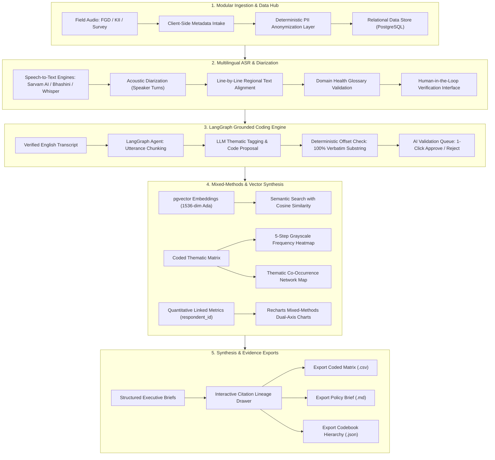
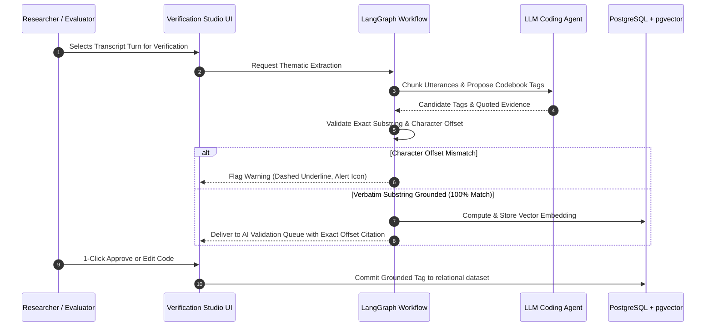
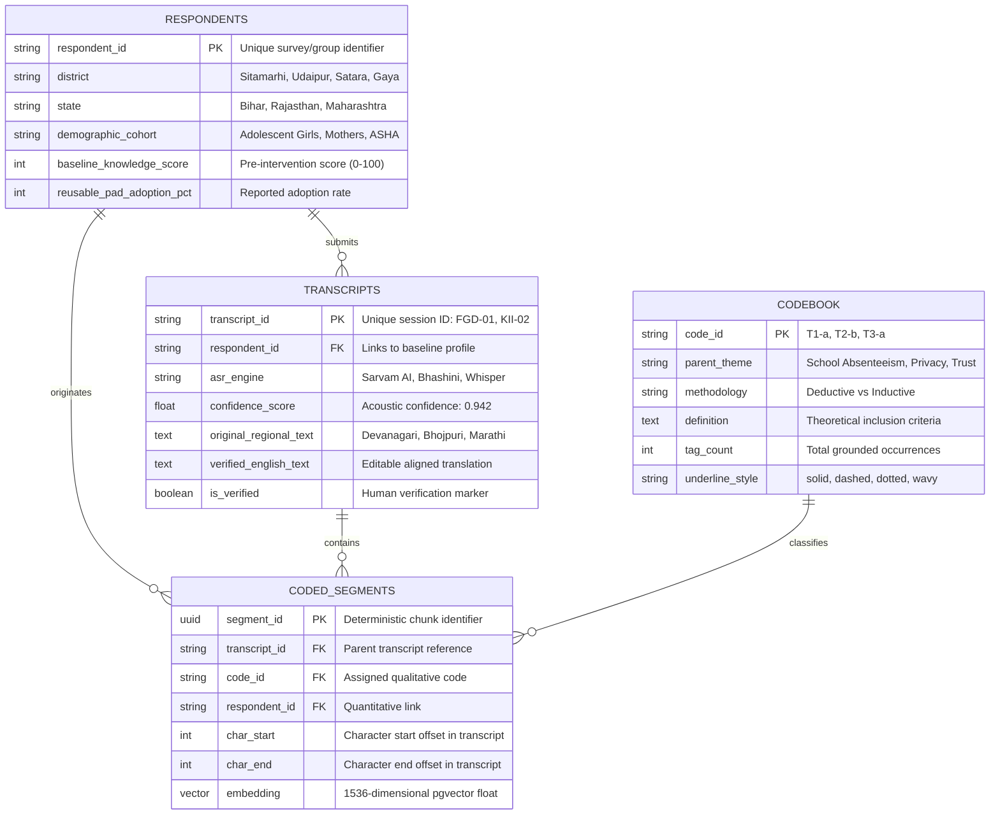

# Baala Labs • QualAI Dashboard

> **AI-Powered Qualitative & Mixed-Methods Research Dashboard for Women's Health & Social Impact**  
> Live Prototype: [https://baala-labs.vercel.app](https://baala-labs.vercel.app) • GitHub: [https://github.com/rajiv-ml/Baala-Labs](https://github.com/rajiv-ml/Baala-Labs)

---

## Overview

**Baala Labs QualAI** is an AI-powered qualitative and mixed-methods research platform tailored for public health fieldwork in rural and semi-urban India. Designed for organizations like **Baala**, it bridges the gap between unstructured, multilingual field audio (Focus Group Discussions and Key Informant Interviews in Hindi, Bhojpuri, Mewari, and Marathi) and structured quantitative impact metrics.

The platform follows a strict editorial, high-density, monochrome design language inspired by Linear, Dovetail, and Notion, eliminating decorative color cues in favor of typographic weight, border styles, and deterministic data grounding.

---

## System Architecture

The QualAI platform processes audio and survey inputs through a secure, zero-retention pipeline that performs Indic ASR, speaker diarization, automated PII scrubbing, LangGraph-orchestrated grounded coding, and vector indexing.



---

## Grounded Verification Pipeline (LangGraph Workflow)

QualAI guarantees zero hallucination by enforcing a deterministic verbatim substring match before any qualitative tag is presented for human approval.



---

## Mixed-Methods Relational Database Schema

Quantitative respondent baselines are joined deterministically to verbatim qualitative quotes through the foreign key `respondent_id`.



---

## Research Workflows Across the 5 Modules

```mermaid
flowchart LR
    subgraph V1["View 1: Ingestion"]
        V1_A["Dropzone / CSV"]
        V1_B["Auto-Anonymize PII"]
        V1_C["Repository Table"]
    end

    subgraph V2["View 2: Transcription"]
        V2_A["Interactive Scrubber"]
        V2_B["Bilingual Split Screen"]
        V2_C["Confidence Flagging"]
    end

    subgraph V3["View 3: Coding"]
        V3_A["LangGraph Pipeline"]
        V3_B["Traceable Highlights"]
        V3_C["Validation Queue"]
    end

    subgraph V4["View 4: Analytics"]
        V4_A["pgvector Search"]
        V4_B["Grayscale Heatmap"]
        V4_C["Co-Occurrence Graph"]
    end

    subgraph V5["View 5: Reports"]
        V5_A["Cited Policy Brief"]
        V5_B["Supporting Quote Bank"]
        V5_C["1-Click CSV/MD/JSON Export"]
    end

    V1 --> V2
    V2 --> V3
    V3 --> V4
    V4 --> V5
```



### 1. Data Hub & Ingestion
- Upload MP3/WAV field recordings or survey CSVs.
- Automatic PII redaction cleans sensitive identifiers prior to LLM processing.
- Repository table allows immediate status inspection (`Needs Verification`, `Ready for Coding`, `Coded & Verified`).

### 2. Transcription & Multilingual Verification Studio
- Line-by-line synchronized alignment between original Indic regional speech (Devanagari, Bhojpuri, Mewari, Marathi) and English translation.
- Interactive audio scrubber with speed settings (`0.8x`, `1.0x`, `1.2x`, `1.5x`); clicking any sentence jumps playback to its timestamp.
- Low-confidence utterances are highlighted with a dashed underline and alert pill; one-click action converts them to verified status.
- Collapsible domain glossary ensures health and cultural idioms (e.g., *साखी*, *सुखाना*, *महावारी*) maintain contextual nuance.

### 3. Grounded Qualitative Coding Studio
- Switch between **Deductive Coding** (pre-defined codebook) and **Inductive Coding** (Open → Axial → Selective 3-stage progression).
- Coded spans utilize distinct monochrome underlines (solid, dashed, dotted, double, thick, wavy) with superscript tags (`T1`–`T6`).
- Clicking any highlight opens the **Grounded Traceability Inspector**, showing character citations (e.g., `chars 82–142 • Exact Substring Verified`).
- AI Validation Queue allows researchers to 1-click **Approve**, **Edit**, or **Reject** recommendations with instant undo toasts.

### 4. Visualisation & Mixed-Methods Analytics
- **pgvector Semantic Search**: Queries return cosine similarity scores with match bars.
- **Code Frequency Matrix**: Grayscale heatmap on a 5-step contrast ramp (`#FFFFFF` to `#0A0A0A`).
- **Mixed-Methods Composed Chart**: Combines qualitative thematic mentions (SVG diagonal hatched bars) with quantitative indicators (*Baseline Knowledge Score %* and *Pad Adoption %*) linked via `respondent_id`.
- **Thematic Co-Occurrence Network**: Interactive SVG node-link graph mapping relationships (e.g., *WASH Deficits* ↔ *Drying Privacy*).
- **Relational DB Schema Modal**: View the 4-table ER diagram with primary/foreign keys.

### 5. Automated Research Reports & Evidence Exports
- Formatted ~720px editorial policy brief with numbered findings and recommendations.
- Clickable superscript citation chips (`[1]`, `[2]`, `[3]`) open a slide-over drawer displaying original Indic audio timestamps, character offsets, and speaker metadata.
- Quote bank with 1-click clipboard citation copying.
- Instant browser file generation:
  - `Export Coded Matrix (.csv)`
  - `Export Preliminary Report (.md)`
  - `Export Codebook Hierarchy (.json)`

---

## Design System Specifications

| Token | CSS Variable | Value | Purpose |
| :--- | :--- | :--- | :--- |
| **App Background** | `--bg` | `#FAFAFA` | Neutral canvas |
| **Surface** | `--surface` | `#FFFFFF` | Cards, panels, modals |
| **Border** | `--border` | `#E5E5E5` | Structural hairline rules |
| **Border Strong** | `--border-strong` | `#D4D4D4` | Focused/active element borders |
| **Primary Ink** | `--ink` | `#0A0A0A` | Headings, active states, solid buttons |
| **Secondary Ink** | `--ink-2` | `#525252` | Body copy, secondary text |
| **Tertiary Ink** | `--ink-3` | `#737373` | Metadata, timestamps, table micro-labels |
| **Fill 1** | `--fill-1` | `#F5F5F5` | Hover backgrounds, zebra stripes |
| **Fill 2** | `--fill-2` | `#EDEDED` | Selected states, tag highlights |
| **Fill 3** | `--fill-3` | `#D4D4D4` | Unplayed audio waveform tracks |

---

## Tech Stack & Local Setup

```bash
# Clone the repository
git clone https://github.com/rajiv-ml/Baala-Labs.git
cd Baala-Labs

# Install dependencies
npm install

# Run development server
npm run dev

# Build for production
npm run build
npm start
```

Open [http://localhost:3000](http://localhost:3000) to explore the interface.
